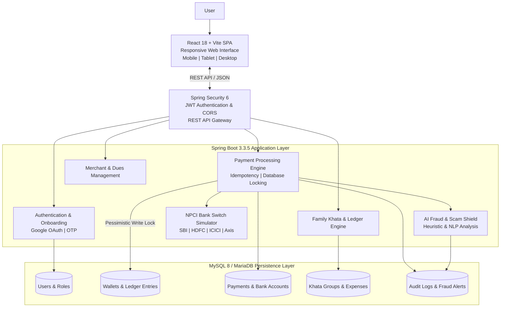

# 💳 SmartPay — Next-Generation Fintech & Unified Payments Platform

<div align="center">


### **Pay Smart. Live Secure.**

[](https://spring.io/projects/spring-boot)
[](https://www.oracle.com/java/)
[](https://reactjs.org/)
[](https://vitejs.dev/)
[](https://tailwindcss.com/)
[](https://www.mysql.com/)
[](https://junit.org/junit5/)
[](LICENSE)

*A full-stack digital payments platform built with Spring Boot, Java 21, React, and MySQL. SmartPay combines wallet management, UPI payment simulation, secure transaction processing, merchant tools, and intelligent fraud detection in a unified, responsive interface.*

</div>

---

## 📑 Table of Contents
1. [Executive Overview](#-executive-overview)
2. [Visual Identity & Design System](#-visual-identity--design-system)
3. [System Architecture](#-system-architecture)
4. [Key Features & Capabilities](#-key-features--capabilities)
5. [Technology Stack](#-technology-stack)
6. [Prerequisites & System Requirements](#-prerequisites--system-requirements)
7. [Installation & Setup Guide](#-installation--setup-guide)
8. [Automated Test Suite & Verification](#-automated-test-suite--verification)
9. [REST API Documentation](#-rest-api-documentation)
10. [Database Architecture (28 Tables)](#-database-architecture-28-tables)
11. [Fintech Security & Concurrency Controls](#-fintech-security--concurrency-controls)
12. [Troubleshooting & FAQ](#-troubleshooting--faq)
13. [Contributing & License](#-contributing--license)

---

## 🌟 Executive Overview

**SmartPay** is a modern digital payment platform built with Spring Boot, Java 21, React, and MySQL. It brings together essential financial services, including peer-to-peer transfers, QR-based payments, bill recharges, recurring payments, merchant management, and real-time transaction tracking.

Designed with a modular architecture and responsive interface, SmartPay focuses on secure transaction processing, reliable payment workflows, and seamless user experiences across desktop, tablet, and mobile devices.

The platform also introduces an AI-assisted Scam Shield concept to identify potentially suspicious payment activities, detect common fraud indicators, and provide contextual security alerts.

### Core Architecture Pillars:
- **Zero Double-Spend Concurrency**: High-frequency wallet debits guarded by pessimistic database locking (`@Lock(LockModeType.PESSIMISTIC_WRITE)`).
- **NPCI UPI Clearing Simulation**: Automated 12-digit Unique Transaction Reference (UTR) generator with deterministic simulated clearing switches.
- **AI Fraud & Scam Shield**: Real-time heuristic scoring detecting remote-access tools (`AnyDesk`, `TeamViewer`, `QuickSupport`), phishing URLs, and fraudulent memo keywords before payment dispatch.
- **Strict Cashly UI Design System**: Calibrated purple-violet gradients (`#5C1DBA` to `#7426E2`), curved mobile headers, and card geometry.

---

## 🎨 Visual Identity & Design System

SmartPay uses a consistent design system inspired by modern digital banking interfaces, combining visual clarity, accessibility, and responsive layouts across desktop, tablet, and mobile devices.

### Design Tokens

| Design Token | Hex Value | Usage |
|---|---|---|
| **Primary Violet** | `#5C1DBA` | Primary actions, navigation highlights, and brand identity |
| **Vibrant Purple** | `#7426E2` | Gradient surfaces, active states, and interactive elements |
| **Electric Purple** | `#8C3CF7` | Floating action buttons, icons, and visual accents |
| **Deep Surface** | `#2C0B5E` | Dark surfaces and bottom navigation containers |
| **Soft Background** | `#F8F9FE` | Main application background and content surfaces |
| **Border Highlight** | `rgba(255,255,255,0.18)` | Subtle borders and translucent card elements |

### Responsive Design

- **Mobile:** 320px–767px
- **Tablet:** 768px–1365px
- **Desktop:** 1366px and above

The interface prioritizes consistent spacing, readable typography, accessible contrast, and intuitive navigation across screen sizes.

---


## 🏛 System Architecture

SmartPay follows a modular client-server architecture with a React-based frontend, a Spring Boot backend, secure REST APIs, and a MySQL persistence layer.




## ⚡ Key Features & Capabilities


SmartPay brings together consumer payments, banking workflows, intelligent security, and merchant utilities in a unified digital payment experience.

### 1. Consumer Payment Suite

- **P2P Money Transfers:** Initiate transfers using mobile numbers, UPI IDs, or bank account details with IFSC codes.
- **QR Code Payments:** Scan supported BharatQR/UPI QR codes and generate payment QR codes with predefined amounts.
- **UPI Lite Concept:** Supports a simulated low-value payment workflow using a locally maintained balance.
- **Recurring Payments & Autopay:** Configure recurring payment schedules for subscriptions, utility bills, and other regular expenses.

### 2. Banking & User Onboarding

- **Google OAuth Integration:** Google-based authentication and user onboarding.
- **Mobile OTP Verification:** Six-digit OTP-based verification with rate-limiting and device-level security checks.
- **Bank Account Discovery Simulator:** Demonstrates account discovery workflows across supported Indian banking institutions, including SBI, HDFC, ICICI, Axis Bank, and Punjab National Bank.

### 3. AI Fraud Detection & Scam Shield

- **Suspicious Activity Detection:** Analyses transaction descriptions and payment-related text for potential scam indicators.
- **Fraud Risk Assessment:** Evaluates suspicious payment patterns using heuristic rules and risk scoring.
- **Security Alerts:** Flags potentially dangerous activities, including remote-access applications, suspicious installation requests, urgent payment demands, and fraudulent payment messages.
- **Transaction Protection:** Demonstrates configurable risk-based transaction blocking and security audit logging.

### 4. Family Khata & Merchant Management

- **Family Khata:** Collaborative expense tracking for shared household expenses, groceries, rent, and travel.
- **Expense Settlement:** Maintains shared contribution records and calculates outstanding balances between group members.
- **Merchant Soundbox Simulator:** Demonstrates payment confirmation announcements with support for multiple Indian regional languages.
- **Customer Dues Ledger:** Maintains customer credit records (*Udhar*), payment history, settlement status, and reminder workflows.

---

## 💻 Technology Stack

| Layer | Technologies |
|---|---|
| **Frontend Framework** | React 18.3, Vite 8.3, React Router DOM 6 |
| **UI & Styling** | Tailwind CSS 3.4, Lucide React, Custom CSS |
| **Backend Framework** | Java 21 LTS, Spring Boot 3.3.5 |
| **API & Communication** | REST APIs, JSON, Axios |
| **Authentication & Security** | Spring Security 6, JWT (jjwt), BCrypt |
| **ORM & Persistence** | Spring Data JPA, Hibernate 6 |
| **Database** | MySQL 8.0 / MariaDB 10.4 |
| **Testing** | JUnit 5, Spring Boot Test, Mockito |
| **API Documentation** | SpringDoc OpenAPI, Swagger UI |
| **Build & Dependency Management** | Apache Maven |
| **Development Environment** | IntelliJ IDEA, VS Code, XAMPP |


---

## 📋 Prerequisites & System Requirements

Before setting up SmartPay, ensure that the following software and development tools are installed.

### Required Software

| Software | Minimum Version | Purpose |
|---|---|---|
| **Java JDK** | 21 LTS | Backend application runtime |
| **Node.js** | 18.x or later | Frontend development environment |
| **npm** | 9.x or later | Frontend dependency management |
| **MySQL Server** | 8.0+ | Relational database |
| **Apache Maven** | 3.8+ | Backend build and dependency management |
| **Git** | 2.40+ | Version control |

### Verify Installation

Run the following commands in your terminal:

```bash
java -version
node -v
npm -v
mysql --version
mvn -version
git --version
```

### Recommended Development Environment

- **IDE:** IntelliJ IDEA or Visual Studio Code
- **Database Management:** phpMyAdmin or MySQL Workbench
- **API Testing:** Postman
- **Operating System:** Windows 10/11, Linux, or macOS

### Hardware Requirements

- **RAM:** 8 GB minimum, 16 GB recommended
- **Storage:** At least 5 GB of available space
- **Processor:** Modern dual-core processor or better
- **Internet:** Required for downloading dependencies and accessing external services.

---

## 🚀 Installation & Setup Guide

### Step 1: Clone the Repository
```bash
git clone https://github.com/<your-username>/SmartPay.git
cd SmartPay
```

### Step 2: Database Setup (MySQL / XAMPP)
1. Start MySQL in **XAMPP Control Panel** or run `mysqld`.
2. Open your MySQL client or phpMyAdmin (`http://localhost/phpmyadmin`).
3. Import the schema and seed data:
```bash
# Using MySQL Command Line Client:
mysql -u root -p < Database/schema.sql
mysql -u root -p < Database/sample-data.sql
```
*(Default XAMPP password is empty; press Enter when prompted for password).*

### Step 3: Configure Environment Variables
Copy `.env.example` to `.env`:
```bash
cp .env.example .env
```
Default configuration connects to `localhost:8080` (Backend) and `localhost:3306` (MySQL).

### Step 4: Run Spring Boot Backend
```bash
cd backend
# Using Maven Wrapper (Windows):
mvnw.bat spring-boot:run

# Using Maven Wrapper (Linux/macOS):
./mvnw spring-boot:run
```
The backend starts at `http://localhost:8080`.
- Swagger UI Documentation: `http://localhost:8080/swagger-ui.html`
- OpenAPI Specification: `http://localhost:8080/v3/api-docs`

### Step 5: Run React Frontend
In a new terminal:
```bash
# Install frontend dependencies:
npm install

# Start Vite development server:
npm run dev -- --host
```
The application opens at `http://localhost:5173`.
To access from a mobile phone on the same Wi-Fi, open `http://<your-lan-ip>:5173`.

---

## 🧪 Automated Test Suite & Verification

SmartPay includes 21 automated integration and unit tests covering all core fintech paths:

```bash
cd backend
mvnw.bat test
```

### Test Suite Execution Summary:
```text
[INFO] -------------------------------------------------------
[INFO]  T E S T S
[INFO] -------------------------------------------------------
[INFO] Running com.smartpay.auth.AuthServiceTest
[INFO] Tests run: 6, Failures: 0, Errors: 0, Skipped: 0 (Auth, Login, JWT, Duplicate Phone)
[INFO] Running com.smartpay.bank.BankServiceTest
[INFO] Tests run: 4, Failures: 0, Errors: 0, Skipped: 0 (Supported Banks, Search, Discovery, Linking)
[INFO] Running com.smartpay.onboarding.OnboardingServiceTest
[INFO] Tests run: 4, Failures: 0, Errors: 0, Skipped: 0 (OTP Simulation, Verify, Failures, Google Auth)
[INFO] Running com.smartpay.payment.PaymentServiceTest
[INFO] Tests run: 5, Failures: 0, Errors: 0, Skipped: 0 (UTR Gen, Idempotency, Insufficient Funds, Scam Shield, History)
[INFO] Running com.smartpay.SmartPayApplicationTests
[INFO] Tests run: 1, Failures: 0, Errors: 0, Skipped: 0 (Spring Context Load)
[INFO] Running com.smartpay.wallet.WalletServiceConcurrencyTest
[INFO] Tests run: 1, Failures: 0, Errors: 0, Skipped: 0 (Pessimistic Concurrency Double-Spend Prevention)
[INFO] 
[INFO] Results:
[INFO] Tests run: 21, Failures: 0, Errors: 0, Skipped: 0
[INFO] ------------------------------------------------------------------------
[INFO] BUILD SUCCESS (100% Passed)
[INFO] ------------------------------------------------------------------------
```

---

## 📡 REST API Documentation

### Authentication & Onboarding
| Method | Endpoint | Description |
|---|---|---|
| `POST` | `/api/v1/auth/login` | Authenticate with phone/email and password/PIN |
| `POST` | `/api/v1/auth/register` | Register new SmartPay user profile |
| `POST` | `/api/v1/auth/google` | Google OAuth token authentication |
| `POST` | `/api/v1/onboarding/mobile/send-otp` | Dispatch 6-digit verification OTP |
| `POST` | `/api/v1/onboarding/mobile/verify-otp` | Validate mobile verification code |

### Payments & Wallet
| Method | Endpoint | Description |
|---|---|---|
| `POST` | `/api/v1/payments/transfer` | Execute P2P or merchant payment with Idempotency Key |
| `GET` | `/api/v1/payments` | Fetch user transaction history |
| `GET` | `/api/v1/payments/{reference}` | Get single transaction receipt by UTR |
| `GET` | `/api/v1/wallet/balance` | Query wallet and UPI Lite balance |
| `POST` | `/api/v1/wallet/add-money` | Top up wallet via linked bank account |
| `POST` | `/api/v1/wallet/toggle-upi-lite` | Enable or disable UPI Lite sub-wallet |

### Banking & NPCI Switch
| Method | Endpoint | Description |
|---|---|---|
| `GET` | `/api/v1/banks` | List supported Indian clearing banks |
| `GET` | `/api/v1/banks/search?query={q}` | Search banks by name or IFSC prefix |
| `POST` | `/api/v1/bank-accounts/discover` | Discover bank accounts via mobile phone |
| `POST` | `/api/v1/bank-accounts/verify` | Link and verify bank account with debit card |
| `GET` | `/api/v1/bank-accounts/{id}/balance`| Query bank core balance |

---

## 🗄 Database Architecture (28 Tables)

```text
smartpay_db
├── 1. users                          ├── 15. offline_transactions
├── 2. roles                          ├── 16. khata_groups
├── 3. user_roles                     ├── 17. khata_members
├── 4. refresh_tokens                 ├── 18. khata_expenses
├── 5. otp_verifications              ├── 19. khata_expense_splits
├── 6. device_sessions                ├── 20. khata_settlements
├── 7. onboarding_sessions            ├── 21. merchant_stores
├── 8. banks                          ├── 22. merchant_dues
├── 9. bank_accounts                  ├── 23. soundbox_configs
├── 10. wallets                       ├── 24. soundbox_voice_alerts
├── 11. wallet_ledger_entries         ├── 25. user_rewards
├── 12. payments                      ├── 26. fraud_alerts
├── 13. autopay_mandates              ├── 27. audit_logs
└── 14. autopay_executions            └── 28. user_notifications
```

---

## 🔒 Fintech Security & Concurrency Controls

1. **Pessimistic Database Locking**:
   When processing transfers, the wallet record is locked using:
   ```java
   @Lock(LockModeType.PESSIMISTIC_WRITE)
   @Query("SELECT w FROM Wallet w WHERE w.userId = :userId")
   Optional<Wallet> findByUserIdWithLock(@Param("userId") Long userId);
   ```
   This guarantees that race conditions (such as clicking 'Pay' 5 times simultaneously) result in strictly serial ledger mutations without balance corruption.

2. **Idempotency De-duplication**:
   Every transfer accepts an `Idempotency-Key` header. If a duplicate key is submitted within the expiry window, the cached transaction receipt is returned immediately without double-debiting.

3. **AES-256 Vault Encryption**:
   Bank account numbers, IFSC codes, and debit card tokens are encrypted at rest with AES-256 GCM before saving to the database.

4. **Rate Limiting & Anti-Brute Force**:
   OTP verification locks down after 5 consecutive failed attempts, requiring a new session handshake.

---

## 🔧 Troubleshooting & FAQ

### Q: Port 8080 or Port 3306 is already in use
- **Port 8080**: Modify `server.port=8081` in `application.yml` and update `VITE_API_BASE_URL` in `.env`.
- **Port 3306**: Ensure XAMPP MySQL is started, or check running services via `netstat -ano | findstr :3306`.

### Q: Mobile phone shows network error connecting to backend
- Ensure your phone and development PC are on the **same Wi-Fi network**.
- Open PowerShell, run `ipconfig`, find your IPv4 address (e.g. `192.168.1.14`).
- Update `.env`: `VITE_API_BASE_URL=http://192.168.1.14:8080/api/v1`.
- Ensure Windows Defender Firewall allows inbound traffic on port 8080.

---

## 📄 Contributing & License

Contributions are welcome! Please fork the repository, create a feature branch, and submit a pull request with unit test coverage.

Distributed under the **MIT License**. See `LICENSE` for more information.

---

<div align="center">
Made with ❤️ by the <b>SmartPay Engineering Team</b>
</div>
