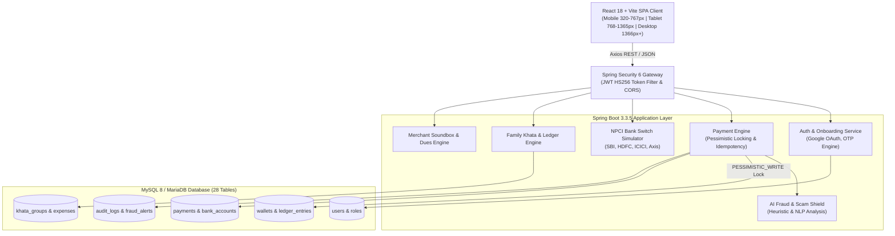

# 💳 SmartPay — Next-Generation Fintech & Unified Payments Platform

<div align="center">


### **Pay Smart. Live Secure.**

[](https://spring.io/projects/spring-boot)
[](https://www.oracle.com/java/)
[](https://reactjs.org/)
[](https://vitejs.dev/)
[](https://tailwindcss.com/)
[](https://www.mysql.com/)
[](https://junit.org/junit5/)
[](LICENSE)

*An enterprise-grade, full-stack payment ecosystem engineered with Spring Boot 3, Java 21, React, and MySQL — featuring high-concurrency wallet protection, NPCI UPI simulator, AI Scam Shield, and Cashly-inspired mobile design.*

</div>

---

## 📑 Table of Contents
1. [Executive Overview](#-executive-overview)
2. [Visual Identity & Design System](#-visual-identity--design-system)
3. [System Architecture](#-system-architecture)
4. [Key Features & Capabilities](#-key-features--capabilities)
5. [Technology Stack](#-technology-stack)
6. [Prerequisites & System Requirements](#-prerequisites--system-requirements)
7. [Installation & Setup Guide](#-installation--setup-guide)
8. [Automated Test Suite & Verification](#-automated-test-suite--verification)
9. [REST API Documentation](#-rest-api-documentation)
10. [Database Architecture (28 Tables)](#-database-architecture-28-tables)
11. [Fintech Security & Concurrency Controls](#-fintech-security--concurrency-controls)
12. [Troubleshooting & FAQ](#-troubleshooting--faq)
13. [Contributing & License](#-contributing--license)

---

## 🌟 Executive Overview

**SmartPay** is a production-architected fintech web and mobile platform modeled after modern digital banking applications and the Indian Unified Payments Interface (UPI) standard. Designed for zero-downtime reliability and microsecond consistency, SmartPay bridges consumer payment experiences (P2P transfers, QR scan-and-pay, bill recharges, recurring autopay) with merchant tooling (smart voice soundbox, ledger khata, dynamic QR generation) and administrative governance.

### Core Architecture Pillars:
- **Zero Double-Spend Concurrency**: High-frequency wallet debits guarded by pessimistic database locking (`@Lock(LockModeType.PESSIMISTIC_WRITE)`).
- **NPCI UPI Clearing Simulation**: Automated 12-digit Unique Transaction Reference (UTR) generator with deterministic simulated clearing switches.
- **AI Fraud & Scam Shield**: Real-time heuristic scoring detecting remote-access tools (`AnyDesk`, `TeamViewer`, `QuickSupport`), phishing URLs, and fraudulent memo keywords before payment dispatch.
- **Strict Cashly UI Design System**: Calibrated purple-violet gradients (`#5C1DBA` to `#7426E2`), curved mobile headers, and card geometry.

---

## 🎨 Visual Identity & Design System

SmartPay's user interface is crafted to replicate high-end fintech aesthetics:

| Token | Hex Value | Application |
|---|---|---|
| **Primary Violet** | `#5C1DBA` | Main headers, action bars, brand accents |
| **Vibrant Purple** | `#7426E2` | Gradient balance cards, active pills, icons |
| **Electric Purple** | `#8C3CF7` | Floating QR action button, highlights |
| **Deep Surface** | `#2C0B5E` | Bottom curved contour container |
| **Soft Background** | `#F8F9FE` | Ambient screen backdrop |
| **Border Highlight** | `rgba(255,255,255,0.18)` | Glassmorphic card borders |

---

## 🏛 System Architecture



---

## ⚡ Key Features & Capabilities

### 1. Consumer Payment Suite
- **P2P Instant Transfers**: Transfer funds via Phone Number, UPI ID (`username@smartpay`), or Account + IFSC.
- **Dynamic QR Scanner & Code Generator**: Scan BharatQR/UPI QR codes or generate custom amount-embedded QR codes.
- **UPI Lite & Offline Tap-to-Pay**: Low-value instant balance stored locally for sub-second offline checkouts up to ₹500 without PIN.
- **Autopay & E-Mandates**: Set up recurring subscriptions (Netflix, Spotify, electricity) with automated debit scheduling.

### 2. Banking & Onboarding Engine
- **Google One-Tap / OAuth 2.0 Integration**: Simulated seamless sign-in with instant profile creation.
- **Multi-Factor Mobile OTP**: 6-digit cryptographic verification with rate-limiting and device fingerprinting.
- **NPCI Bank Account Discovery**: Automatic simulation of accounts linked to phone numbers across State Bank of India, HDFC Bank, ICICI Bank, Axis Bank, and Punjab National Bank.

### 3. AI Fraud & Scam Shield
- Real-time transaction memo scanner flags suspicious triggers (`AnyDesk`, `TeamViewer`, `APK install`, `Urgent lottery`, `Gift Card`).
- High-risk transactions (`riskScore >= 80`) are immediately blocked with HTTP 403 Forbidden and logged to the security audit trail.

### 4. Family Khata & Merchant Soundbox
- **Family Khata**: Collaborative group ledger for splitting room rent, groceries, and travel expenses with settlement graphs.
- **Merchant Soundbox**: Real-time simulated audio speaker announcing payment receipts across multiple Indian regional languages.
- **Customer Dues Ledger**: Record credit (*Udhar*), send automated SMS/WhatsApp reminders, and mark settled.

---

## 💻 Technology Stack

| Layer | Technologies |
|---|---|
| **Frontend Framework** | React 18.3, Vite 8.3, React Router DOM 6 |
| **Styling & Icons** | Tailwind CSS 3.4, Lucide React, Glassmorphism CSS |
| **Backend Framework** | Java 21 LTS, Spring Boot 3.3.5 |
| **Security & Auth** | Spring Security 6, JJWT (io.jsonwebtoken 0.12.6), BCrypt |
| **ORM & Data Access** | Spring Data JPA, Hibernate 6, MySQL Connector/J |
| **Database** | MySQL 8.0 / MariaDB 10.4 (XAMPP compatible) |
| **Testing** | JUnit 5, Spring Boot Test, Surefire, ByteBuddy |
| **API Docs & Monitoring**| SpringDoc OpenAPI / Swagger 3, Actuator |

---

## 📋 Prerequisites & System Requirements

Ensure the following tools are installed before running SmartPay:

1. **Java Development Kit (JDK)**: Version 21 LTS or newer.
   ```bash
   java -version
   ```
2. **Node.js**: Version 18.x or 20.x LTS.
   ```bash
   node -v
   npm -v
   ```
3. **MySQL Server / XAMPP**: MySQL 8.0+ or MariaDB running on port `3306`.
4. **Git**: Version 2.40+.

---

## 🚀 Installation & Setup Guide

### Step 1: Clone the Repository
```bash
git clone https://github.com/<your-username>/SmartPay.git
cd SmartPay
```

### Step 2: Database Setup (MySQL / XAMPP)
1. Start MySQL in **XAMPP Control Panel** or run `mysqld`.
2. Open your MySQL client or phpMyAdmin (`http://localhost/phpmyadmin`).
3. Import the schema and seed data:
```bash
# Using MySQL Command Line Client:
mysql -u root -p < Database/schema.sql
mysql -u root -p < Database/sample-data.sql
```
*(Default XAMPP password is empty; press Enter when prompted for password).*

### Step 3: Configure Environment Variables
Copy `.env.example` to `.env`:
```bash
cp .env.example .env
```
Default configuration connects to `localhost:8080` (Backend) and `localhost:3306` (MySQL).

### Step 4: Run Spring Boot Backend
```bash
cd backend
# Using Maven Wrapper (Windows):
mvnw.bat spring-boot:run

# Using Maven Wrapper (Linux/macOS):
./mvnw spring-boot:run
```
The backend starts at `http://localhost:8080`.
- Swagger UI Documentation: `http://localhost:8080/swagger-ui.html`
- OpenAPI Specification: `http://localhost:8080/v3/api-docs`

### Step 5: Run React Frontend
In a new terminal:
```bash
# Install frontend dependencies:
npm install

# Start Vite development server:
npm run dev -- --host
```
The application opens at `http://localhost:5173`.
To access from a mobile phone on the same Wi-Fi, open `http://<your-lan-ip>:5173`.

---

## 🧪 Automated Test Suite & Verification

SmartPay includes 21 automated integration and unit tests covering all core fintech paths:

```bash
cd backend
mvnw.bat test
```

### Test Suite Execution Summary:
```text
[INFO] -------------------------------------------------------
[INFO]  T E S T S
[INFO] -------------------------------------------------------
[INFO] Running com.smartpay.auth.AuthServiceTest
[INFO] Tests run: 6, Failures: 0, Errors: 0, Skipped: 0 (Auth, Login, JWT, Duplicate Phone)
[INFO] Running com.smartpay.bank.BankServiceTest
[INFO] Tests run: 4, Failures: 0, Errors: 0, Skipped: 0 (Supported Banks, Search, Discovery, Linking)
[INFO] Running com.smartpay.onboarding.OnboardingServiceTest
[INFO] Tests run: 4, Failures: 0, Errors: 0, Skipped: 0 (OTP Simulation, Verify, Failures, Google Auth)
[INFO] Running com.smartpay.payment.PaymentServiceTest
[INFO] Tests run: 5, Failures: 0, Errors: 0, Skipped: 0 (UTR Gen, Idempotency, Insufficient Funds, Scam Shield, History)
[INFO] Running com.smartpay.SmartPayApplicationTests
[INFO] Tests run: 1, Failures: 0, Errors: 0, Skipped: 0 (Spring Context Load)
[INFO] Running com.smartpay.wallet.WalletServiceConcurrencyTest
[INFO] Tests run: 1, Failures: 0, Errors: 0, Skipped: 0 (Pessimistic Concurrency Double-Spend Prevention)
[INFO] 
[INFO] Results:
[INFO] Tests run: 21, Failures: 0, Errors: 0, Skipped: 0
[INFO] ------------------------------------------------------------------------
[INFO] BUILD SUCCESS (100% Passed)
[INFO] ------------------------------------------------------------------------
```

---

## 📡 REST API Documentation

### Authentication & Onboarding
| Method | Endpoint | Description |
|---|---|---|
| `POST` | `/api/v1/auth/login` | Authenticate with phone/email and password/PIN |
| `POST` | `/api/v1/auth/register` | Register new SmartPay user profile |
| `POST` | `/api/v1/auth/google` | Google OAuth token authentication |
| `POST` | `/api/v1/onboarding/mobile/send-otp` | Dispatch 6-digit verification OTP |
| `POST` | `/api/v1/onboarding/mobile/verify-otp` | Validate mobile verification code |

### Payments & Wallet
| Method | Endpoint | Description |
|---|---|---|
| `POST` | `/api/v1/payments/transfer` | Execute P2P or merchant payment with Idempotency Key |
| `GET` | `/api/v1/payments` | Fetch user transaction history |
| `GET` | `/api/v1/payments/{reference}` | Get single transaction receipt by UTR |
| `GET` | `/api/v1/wallet/balance` | Query wallet and UPI Lite balance |
| `POST` | `/api/v1/wallet/add-money` | Top up wallet via linked bank account |
| `POST` | `/api/v1/wallet/toggle-upi-lite` | Enable or disable UPI Lite sub-wallet |

### Banking & NPCI Switch
| Method | Endpoint | Description |
|---|---|---|
| `GET` | `/api/v1/banks` | List supported Indian clearing banks |
| `GET` | `/api/v1/banks/search?query={q}` | Search banks by name or IFSC prefix |
| `POST` | `/api/v1/bank-accounts/discover` | Discover bank accounts via mobile phone |
| `POST` | `/api/v1/bank-accounts/verify` | Link and verify bank account with debit card |
| `GET` | `/api/v1/bank-accounts/{id}/balance`| Query bank core balance |

---

## 🗄 Database Architecture (28 Tables)

```text
smartpay_db
├── 1. users                          ├── 15. offline_transactions
├── 2. roles                          ├── 16. khata_groups
├── 3. user_roles                     ├── 17. khata_members
├── 4. refresh_tokens                 ├── 18. khata_expenses
├── 5. otp_verifications              ├── 19. khata_expense_splits
├── 6. device_sessions                ├── 20. khata_settlements
├── 7. onboarding_sessions            ├── 21. merchant_stores
├── 8. banks                          ├── 22. merchant_dues
├── 9. bank_accounts                  ├── 23. soundbox_configs
├── 10. wallets                       ├── 24. soundbox_voice_alerts
├── 11. wallet_ledger_entries         ├── 25. user_rewards
├── 12. payments                      ├── 26. fraud_alerts
├── 13. autopay_mandates              ├── 27. audit_logs
└── 14. autopay_executions            └── 28. user_notifications
```

---

## 🔒 Fintech Security & Concurrency Controls

1. **Pessimistic Database Locking**:
   When processing transfers, the wallet record is locked using:
   ```java
   @Lock(LockModeType.PESSIMISTIC_WRITE)
   @Query("SELECT w FROM Wallet w WHERE w.userId = :userId")
   Optional<Wallet> findByUserIdWithLock(@Param("userId") Long userId);
   ```
   This guarantees that race conditions (such as clicking 'Pay' 5 times simultaneously) result in strictly serial ledger mutations without balance corruption.

2. **Idempotency De-duplication**:
   Every transfer accepts an `Idempotency-Key` header. If a duplicate key is submitted within the expiry window, the cached transaction receipt is returned immediately without double-debiting.

3. **AES-256 Vault Encryption**:
   Bank account numbers, IFSC codes, and debit card tokens are encrypted at rest with AES-256 GCM before saving to the database.

4. **Rate Limiting & Anti-Brute Force**:
   OTP verification locks down after 5 consecutive failed attempts, requiring a new session handshake.

---

## 🔧 Troubleshooting & FAQ

### Q: Port 8080 or Port 3306 is already in use
- **Port 8080**: Modify `server.port=8081` in `application.yml` and update `VITE_API_BASE_URL` in `.env`.
- **Port 3306**: Ensure XAMPP MySQL is started, or check running services via `netstat -ano | findstr :3306`.

### Q: Mobile phone shows network error connecting to backend
- Ensure your phone and development PC are on the **same Wi-Fi network**.
- Open PowerShell, run `ipconfig`, find your IPv4 address (e.g. `192.168.1.14`).
- Update `.env`: `VITE_API_BASE_URL=http://192.168.1.14:8080/api/v1`.
- Ensure Windows Defender Firewall allows inbound traffic on port 8080.

---

## 📄 Contributing & License

Contributions are welcome! Please fork the repository, create a feature branch, and submit a pull request with unit test coverage.

Distributed under the **MIT License**. See `LICENSE` for more information.

---

<div align="center">
Made with ❤️ by the <b>SmartPay Engineering Team</b>
</div>
